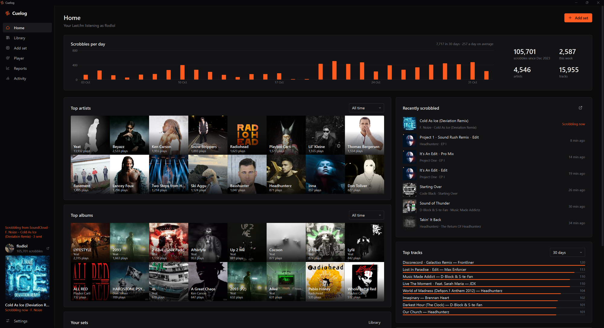

<div align="center">
  <h1>Cuelog</h1>
  <p>A Windows desktop app that turns the SoundCloud DJ sets you listen to into individual Last.fm scrobbles,<br> plus a full Last.fm stats dashboard for music enthusiasts.</p>

[](#status) [](LICENSE) [](https://www.python.org/) [](https://doc.qt.io/qtforpython-6/) [](#getting-started) [](#privacy)

</div>

> [!WARNING]
> **Work in progress.** Cuelog works and I use it every day, but it's still changing a lot. Expect rough edges,
> breaking changes to the database between versions, and no installer yet (you run it from source).

---

## What is this?

If you listen to DJ sets on SoundCloud (Defqon.1, Q-dance, festival recordings, radio shows…), Last.fm normally
sees nothing, or one hour-long "track". Cuelog fixes that: save a set once, match its tracklist to the real
recordings, and every listen becomes the **individual songs** in your Last.fm history, with the right timestamps.

On top of that it's a proper stats app for your Last.fm account: top artists and albums, scrobbles per day,
listening clock, weekly and monthly reports, and top tags, all from your full Last.fm history.

<br>

<div align="center">
  
</div>

<br>

---

## Why This Exists

A lot of what I listen to is DJ sets, and none of it showed up on Last.fm. My stats were missing the music I
actually listen to most.

- **SoundCloud scrobblers?** They scrobble the whole mix as one track, if anything at all.
- **Manually scrobbling a tracklist?** Fine once, painful for a set you play 100 times.
- **Web tools?** I didn't want another browser tab or a server holding my Last.fm session.

So I built a desktop app that does it properly and stays on my PC.

---

## Features

- **Paste a SoundCloud link** — Normal, share, mobile and `on.soundcloud.com` links all work
- **Tracklist parsing** — Pulls the tracklist from the description (numbered, timestamped or plain `Artist - Title`) or lets you paste/edit it
- **Smart matching** — Matches every song to its official Spotify recording (or MusicBrainz without Spotify), version-aware, so a different remix is never auto-picked
- **Timeline** — See and drag where each song starts in the mix; missing timestamps are estimated and labelled
- **Log another listen** — One click for every repeat listen, with a preview of the exact scrobbles
- **Backfill** — Log past listens in bulk, clearly marked as reconstructed timestamps
- **Built-in player** — Listen in Cuelog's player; only the parts you actually played are scrobbled
- **SoundCloud detection** — Notices a set playing in the SoundCloud app or browser: scrobbles it live if it's in your library, otherwise offers to add it
- **Safe Last.fm import queue** — Batching, rate limits, a daily cap, crash recovery and duplicate prevention
- **Last.fm stats** — Home dashboard with top artists/albums/tracks, scrobbles per day and recent tracks
- **Reports** — Per year: weekly scrobbles vs last year, listening clock, top tags stream graph, scrobbles per month, top artists
- **Colour schemes & zoom** — Pick an accent and background; `Ctrl +` / `Ctrl −` to scale the whole UI
- **Exports & backups** — CSV/JSON exports and database backup/restore

---

## Getting Started

### Requirements

- Windows 10 or 11
- Python 3.10+ from [python.org](https://www.python.org/downloads/)
- A Last.fm account and a (free) [Last.fm API account](https://www.last.fm/api/account/create)

### Run it locally

```bash
# Clone the repo
git clone https://github.com/flodlol/Cuelog.git
cd Cuelog

# Start (creates a private .venv on first run, takes about a minute)
start.bat
```

Or by hand:

```bash
python -m venv .venv
.venv\Scripts\pip install -r requirements.txt
.venv\Scripts\pythonw -m cuelog
```

Add `--setup` to show the setup check again.

### Accounts

| Account | Required? | What it's for | Where |
|---|---|---|---|
| **Last.fm API account** | Yes | API key + shared secret | https://www.last.fm/api/account/create (any app name, no callback URL needed) |
| Last.fm login | Yes | Click **Connect Last.fm** in Settings and approve in the browser | – |
| Spotify app | Optional | Better matching, official metadata, artwork and artist photos (client credentials, no Spotify login) | https://developer.spotify.com/dashboard |
| SoundCloud app | Optional | Richer metadata, your playlists and likes | https://soundcloud.com/you/apps (reviewed by SoundCloud) |

Credentials go in **Settings** and are saved to `settings.env` (see `.env.example`). That file is git-ignored.
Session tokens are stored in the local database, encrypted with your Windows account (DPAPI).

---

## How It Works

The app is written in **Python** with **PySide6** (Qt 6 widgets). Everything is stored in a local **SQLite**
database; there's no server.

### Architecture

```
cuelog/
├── app.py, __main__.py   --> Entry point
├── db.py, repo.py        --> SQLite schema, migrations and data access
├── tracklist.py          --> Tracklist parsing
├── matching.py           --> Song matching (Spotify / MusicBrainz) and ranking
├── scheduler.py          --> Song timing within a mix, listens and backfill
├── jobs.py               --> Last.fm import engine (batches, retries, dedupe, recovery)
├── live.py, media.py     --> Live scrobbling and SoundCloud detection (Windows media sessions)
├── history.py            --> Local mirror of your Last.fm history for reports
├── lastfm.py, spotify.py, soundcloud.py, musicbrainz.py  --> API clients
├── player_proc.py        --> Player window (WebView2 + SoundCloud widget)
└── ui/                   --> Qt interface (pages, dialogs, charts, theme)
tests/                    --> pytest suite
docs/DATA_SCHEMA.md       --> Legacy CSV formats
```

### What Last.fm receives

- **Artist:** the **first** credited artist (e.g. *Headhunterz* for "Headhunterz, Wildstylez, Noisecontrollers"). All artists stay visible in Cuelog.
- **Title and album:** the official track title and album name.
- **Timestamp:** when that song started within your listen, based on the set's timeline.
- **Duration:** the recording's length (optional).

### Last.fm rules Cuelog respects

- Scrobbles older than **14 days** are ignored by Last.fm, so Cuelog uses 13 days and never sends future timestamps. Older listens get an explicitly labelled **reconstructed timestamp**.
- At most 50 scrobbles per request, a pause between requests, and a daily cap (default 2,800) below Last.fm's limit.
- **No double scrobbles:** every scrobble has a permanent identity, and after a timeout Cuelog checks your Last.fm history before retrying. Songs already scrobbled within ±90 s are skipped.
- Every request is logged (without secrets) in **Activity**.

### SoundCloud detection

Windows exposes what's playing through its media controls (the same thing your volume flyout shows). Cuelog reads
that every few seconds. When a long SoundCloud upload is playing, it compares the title, uploader and length with
your saved sets. If one matches, it follows along and scrobbles the songs as they play.

---

## Tech Stack

| Category | Technology |
|----------|------------|
| UI | PySide6 (Qt 6 Widgets), custom painted charts |
| Storage | SQLite |
| Player | pywebview + Microsoft Edge WebView2 |
| Media detection | WinRT `Windows.Media.Control` |
| APIs | Last.fm, Spotify, SoundCloud, MusicBrainz, Cover Art Archive, Deezer (images) |
| Tests | pytest |
| Language | Python 3.10+ |

---

## Privacy

**Everything stays on your PC.**

- No Cuelog server, no accounts, no analytics
- Your listening data lives in a local SQLite database (`data/`)
- API credentials stay in `settings.env`; tokens are encrypted with Windows DPAPI
- Cuelog only talks to the music APIs listed above

---

## Status

Cuelog is a **work in progress**. Things on the list:

- [ ] Packaged `Cuelog.exe` with Start menu shortcut and its own data folder
- [ ] Better tracklist extraction for sets without a description
- [ ] More reports (artist and tag deep dives)
- [ ] Polishing, polishing, polishing

Known limitations:

- **Windows only** (WebView2 player, DPAPI, Windows media sessions).
- **SoundCloud has no listening-history API**, so only listens Cuelog sees (player, detection, or logged by you) count.
- **Last.fm** can't accept timestamps older than 14 days, so historical listens use reconstructed timestamps.

---

## Development

```bash
.venv\Scripts\python -m pytest tests
```

The tests cover tracklist and URL parsing, matching, timing, repeat listens and backfill, the import engine
against a simulated Last.fm (partial acceptance, limits, timeouts, crash recovery, duplicates), live scrobbling,
legacy migration, and a UI smoke test.

---

## Contributing

It's early, but issues and ideas are very welcome. Found a set that doesn't parse or match well? Open an issue
with the SoundCloud link.

1. Fork the repo
2. Create a branch (`git checkout -b my-feature`)
3. Make your changes and run the tests
4. Open a pull request

---

## License

MIT — do whatever you want with it.

---

<div align="center">
  If you find this useful, a star on GitHub would be nice. ⭐ <br/>
  Thanks for checking it out! ❤️
  <br/>
  <a href="https://github.com/sponsors/flodlol">Sponsor this project</a>
</div>
